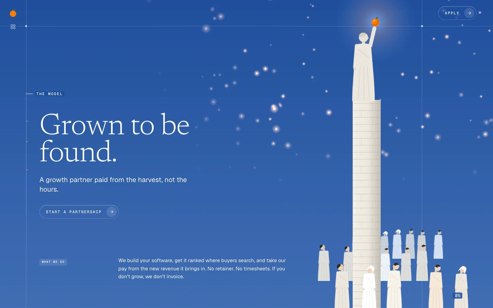
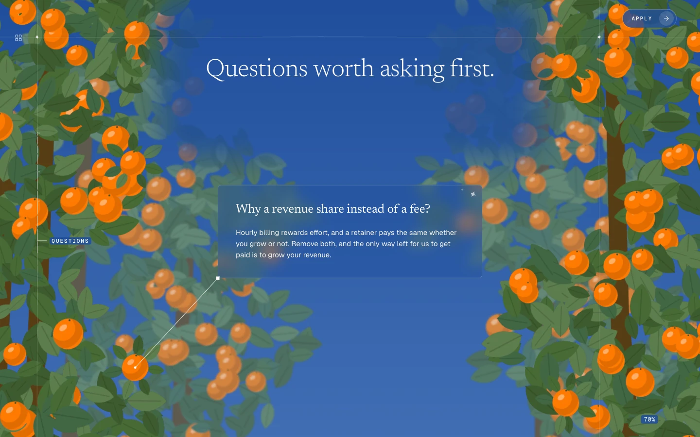

# orange-story

The orange.io website: one continuous scroll story about a growth partner paid from the harvest, not the hours.

The whole site is a single pinned stage, about 53 screens of ordinary scrolling. As the visitor scrolls, painted scenes of an orange tree, its keepers and its harvest pass by in 2.5D (flat painted plates at different depths, filmed by a moving camera), and the text arrives and leaves in set places: four chapters, The Model, The Work, The Terms and Questions, and a finale. Everything is driven by one scroll position, so scrolling back up plays the story backwards exactly. The artwork is placeholder for now: tidy silhouettes standing in for the paintings, at the paths the final plates will use.





## The story

- **The Model:** a statue raises a glowing orange; her minaret grows into a tree, a cutting is grafted on, a hand plucks the fruit for a harvester who cuts it and shares the halves.
- **The Work:** the three services drift past in the clouds, then an architect unfolds the plan of a minaret in its scaffold.
- **The Terms:** a building site by the sea seen from straight above, with the terms beside it; a gardener prunes, and an orange falls through a rainbow ring into an orchard.
- **Questions:** five questions on glass cards, each tied to an orange in the trees; a stargazer's constellation; the application form.
- **Finale:** the orchard keepers water and trim the tree inside a closing frame, under the Orange wordmark.

`docs/STORYBOARD.md` describes every scene and holds the copy deck.

## Tech stack

Versions from `package.json`:

- **Next.js 16.4.0** (App Router, Turbopack, Cache Components) with **React 19.3.0** and **TypeScript 5**
- **React Three Fiber 9.8** and **three.js 0.186** for the painted stage and the transitions (**drei 10.7** is installed, not used yet)
- **GSAP 3.15** (ScrollTrigger maps the scroll to one progress value; the camera path is a GSAP timeline) and **Lenis 1.3** (wheel smoothing)
- **Motion 14.1** (`motion/react`) for the text and DOM animation
- **Tailwind CSS 4**, **shadcn/ui** on **Radix UI 1.7**, **lucide-react 1.54** icons
- **react-hook-form 7.89** and **zod 3.25** for the application form
- **Vitest 4.1** (unit tests), **Playwright 1.64** (the scroll test), **ESLint 9**, **sharp 0.35** (placeholder art)
- Fonts: Newsreader, Geist and Geist Mono, through `next/font`

## Getting started

Node 22 (what CI uses).

```bash
npm install
npm run dev        # http://localhost:3000 (press ` for the dev timeline; /design is the dev-only lab)
npm run build      # production build
npm run start      # serve the production build
npm test           # unit tests (Vitest): the script, the scene plans, the camera, the design rules
npm run lint
```

The scroll test walks the whole story in Chromium on a laptop screen and on a phone, checks every scene against the script, comes back up and checks it again, and saves a screenshot per scene to `test-results/story/`:

```bash
npx playwright install chromium   # once
npm run test:story                # builds, serves on port 3100, runs e2e/story.spec.ts
```

`npm run art:placeholders` redraws every placeholder plate (`-- --check` only verifies that every plate's file exists at its listed size).

## Project structure

| Path | What it is |
| --- | --- |
| `src/app/` | The layout, the one page, `globals.css` (tokens, Tailwind theme, utilities) and the dev-only `/design` lab |
| `src/content/copy.ts` | Every string on screen |
| `src/scroll/script.ts` | The story as data: stage length, chapters, scenes, beats, transitions, camera keys, per-scene timings |
| `src/scroll/` | Also the scroll engine (`stage-scroll.ts`), helpers, validation, phones (`mobile.ts`) and navigation |
| `src/components/story/` | The pinned stage, the text beats, the question deck, the form, the reduced-motion page, the screen reader outline |
| `src/components/stage/` | The WebGL stage: plates, materials, camera rig and path, and one art component plus a pure plan per scene |
| `src/components/transitions/` | Sand, paper unfold, rising dust, rainbow ring and fabric sky: choreography and shaders |
| `src/components/chrome/` | Mark, chapter menu, ruler, percent counter, hairlines |
| `src/components/motion/` | Text effects: per-letter reveal, typewriter, blur fade, smoke |
| `src/components/ui/` | shadcn/ui components (button, tag, form fields, sheet, tooltip) |
| `src/styles/` | The fonts, and the tokens for code (`tokens.ts`) |
| `src/art/manifest.ts`, `public/art/` | The art manifest and the plates |
| `scripts/art-placeholders.mjs` | Draws the placeholder plates |
| `e2e/story.spec.ts`, `playwright.config.ts` | The scroll test |
| `DESIGN.md` | The design system: palette, contrast, type, shapes, grid, motion |
| `SCROLL.md` | The script in prose, with the tuned numbers, the storyboard check and performance |
| `docs/` | Storyboard, art plates, technique reference, how the build ran, screenshots |
| `deploy/`, `.github/workflows/` | CI and the deployment |

## Editing

**Copy.** Every string is in `src/content/copy.ts`; components never hold text. The script refers to copy by key (`model.found`, `work.cards.0`), and `npm test` fails if a key is missing.

**Art.** Every plate is listed in `public/art/manifest.json`: its file, pixel size, depth, anchor and world height. To add a painting, save it as WebP with alpha at the entry's path and size (or change `size`), then delete the entry's `placeholder` spec so the generator never overwrites it; no code changes. `npm test` checks every file against the manifest. `docs/ART-PLATES.md` lists the plates per scene and what final art must keep (a sky that stays dark enough behind text, nothing cut by its image edge, orchard rows that fade out at their foot).

**Pacing.** Everything that moves is placed in `src/scroll/script.ts`: `STAGE_VH` (the stage length), the scene shares, the beats, the transitions, the camera keys and each scene's own timing object. Positions inside a scene move with it when its share changes; text lengths are in screens. `validateScript()` stops the page in development on an impossible script (and fails `npm test`), the dev timeline (the backtick key) shows the live values, and `SCROLL.md` explains every number. Run `npm test` and `npm run test:story` after a change.

## Accessibility and reduced motion

- With reduced motion the page is a calm stacked page instead (chosen by CSS before any script runs): every chapter in order, one still per scene, all the copy, the questions as a plain list, and the form.
- The stage is decorative to screen readers; a visually hidden outline carries the chapters as landmarks, every beat in order, the questions as one list, and a link to the form.
- A skip link goes straight to the form; J and K step through the text beats; `#model`, `#work`, `#terms`, `#questions` and `#apply` deep links land in the right place (`#apply` focuses the first field), and a reload comes back where the reader was.
- Native scrolling throughout: Lenis smooths the wheel only, touch keeps its momentum, nothing hijacks scrolling.
- Text meets WCAG AA on the sky and on milk (`DESIGN.md` has the measured ratios); where painted art runs behind words it recedes while they are up.

## Deployment

- It is a Node app: `npm run build`, then `npm run start` (port 3000). The page is prerendered as a static shell (Cache Components is on; the copyright year is cached for a day in `src/lib/story-year.ts`). Partial Prefetching is on too; with one route and no links to other routes it changes nothing today.
- **Set `NEXT_PUBLIC_APPLY_ENDPOINT` before going live** (see `.env.example`). The form posts its fields as JSON there; without it, the form validates and shows its success message but sends nothing. The value is read at build time, so set it before `npm run build`.
- CI (`.github/workflows/ci.yml`) runs lint, the unit tests and the build on every pull request. The scroll test is not in CI; run `npm run test:story` locally.
- Pushes to `main` deploy to the production server through `.github/workflows/deploy.yml` (an EC2 instance behind nginx, reached over AWS Systems Manager); `deploy/README.md` has the details and how to roll back.

## Credits

The artwork is placeholder, drawn by `scripts/art-placeholders.mjs`, until the original paintings are added. Copy and code are original to Orange. Newsreader, Geist and Geist Mono are served from Google Fonts through `next/font`. The site was built phase by phase with Claude Code (`docs/BUILD.md`).
